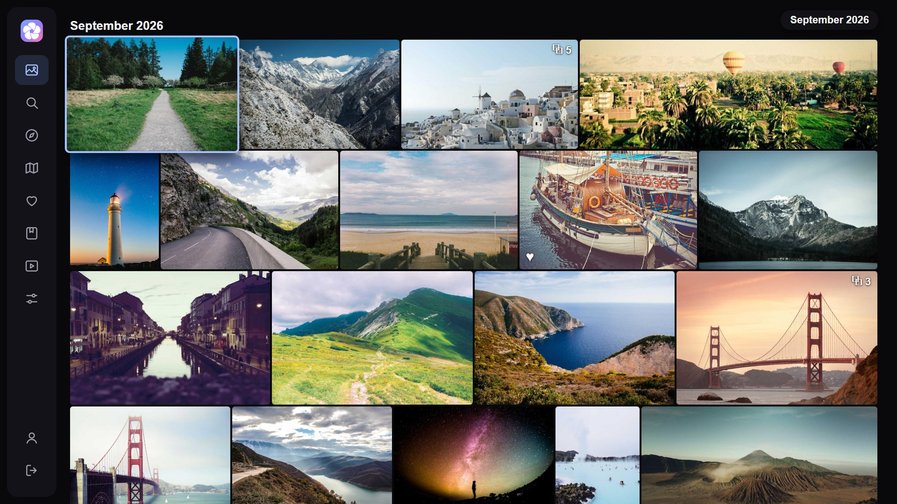
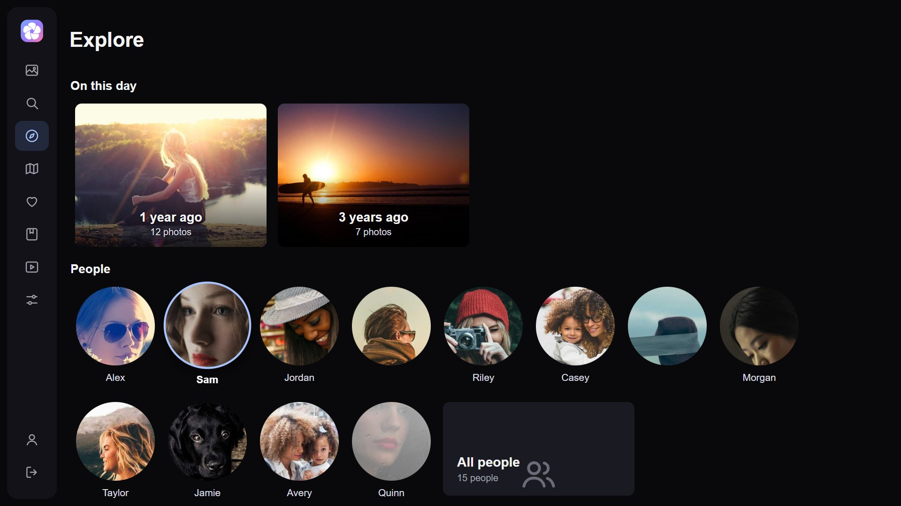
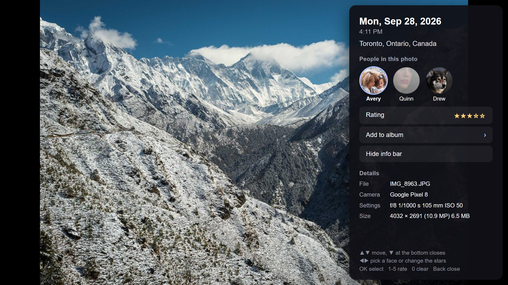
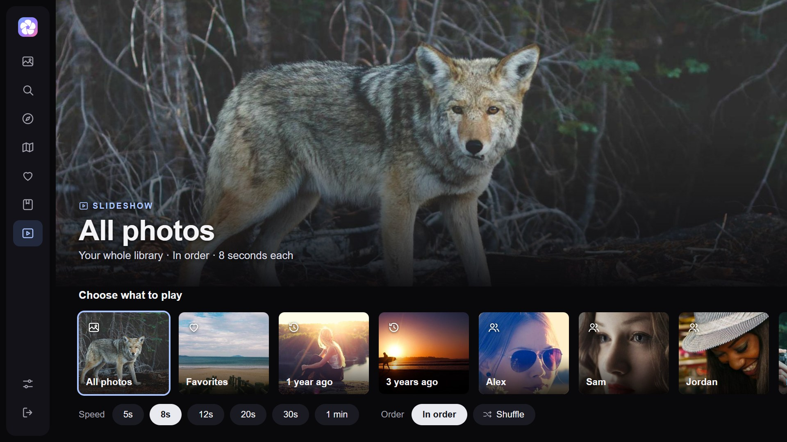
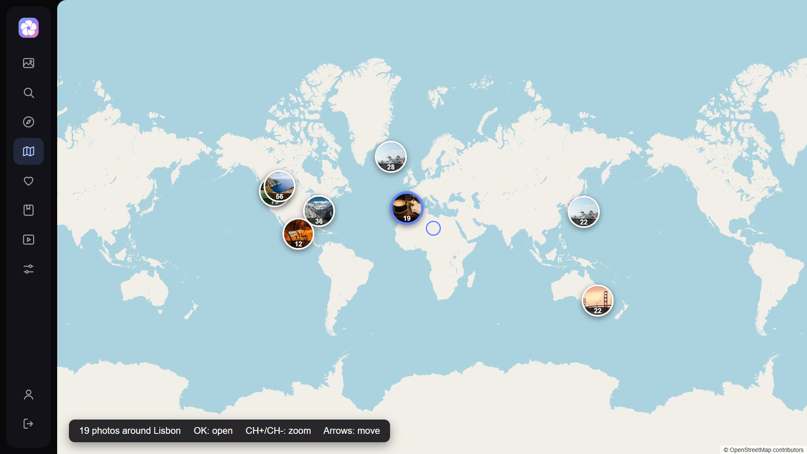
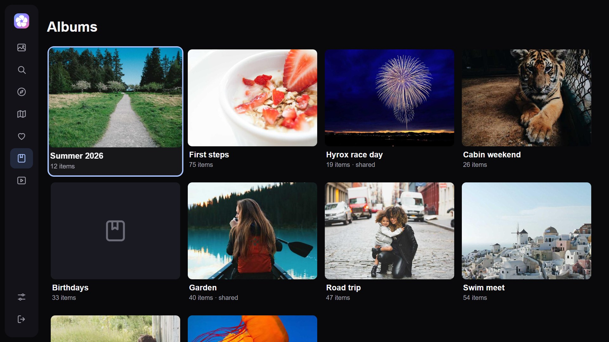
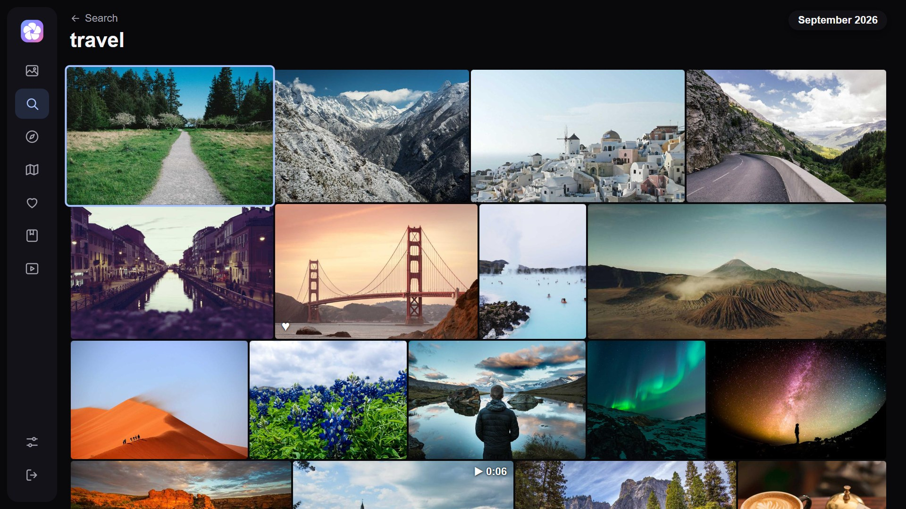
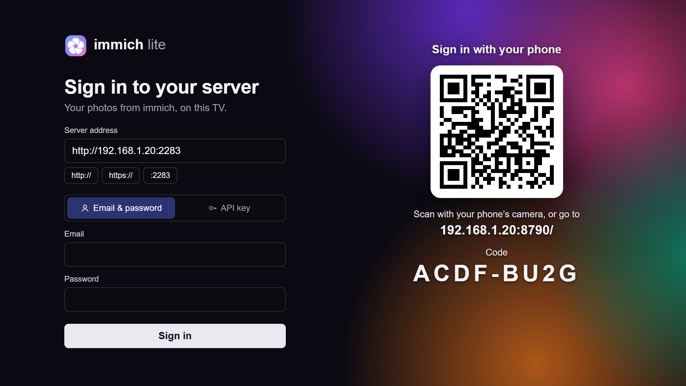
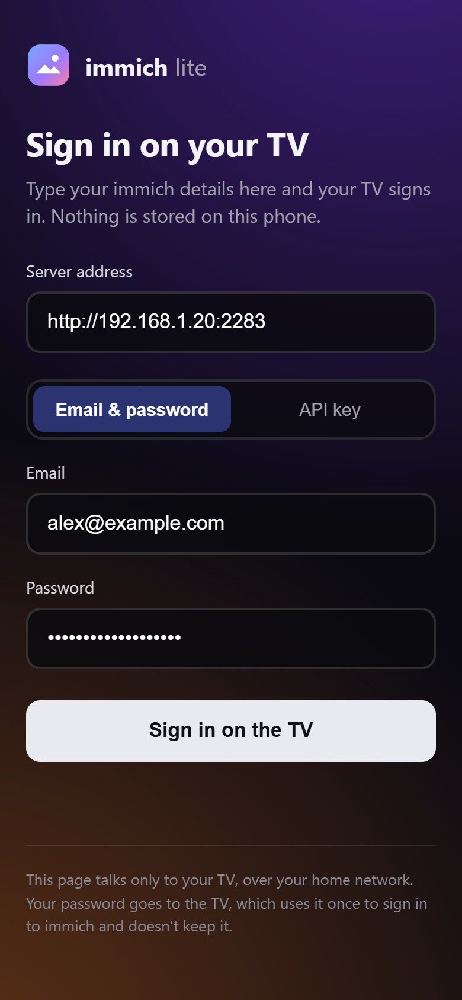

<p align="center">
  
</p>

<h1 align="center">immich lite</h1>

<p align="center">
  Your <a href="https://immich.app">immich</a> photos and videos on older LG TVs, the ones current immich TV apps can't run on.
</p>

<p align="center">
  
  
  
  <a href="LICENSE"></a>
</p>

<p align="center">
  
</p>

> Unofficial community client. Not affiliated with or endorsed by immich or FUTO.

LG's 2016–2019 TVs still make good screens, but their built-in browser engine is too old for modern web apps. The webOS immich clients need webOS 5.0 or newer and show a black screen on anything older. immich lite is written for the oldest engine on purpose: plain ES5 JavaScript and CSS, no frameworks and no build step, so it runs on a 2016 set.

Inspired by [immich webOS](https://github.com/aneeshtigga/immich-webos) by Aneesh Tigga. **If your TV runs webOS 5.0 or newer, use that instead.**

## Which app is right for your TV?

| Your TV | Use |
|---|---|
| webOS 3.x (2016–2017 models) | **immich lite** (this app) |
| webOS 4.x (2018–2019 models) | **immich lite**. It should work, since webOS 4 has a newer engine (Chrome 53) than the one this app is written for, but it hasn't been tried yet |
| webOS 5.0 and newer (2020 on) | [immich webOS](https://github.com/aneeshtigga/immich-webos), from the Homebrew Channel |

To check your version, open **Settings → All Settings → General → About This TV** on the TV.

## Status: pre-alpha

- Works in a desktop browser, tested against the dev server's fake library. It has **not been run on a TV yet**.
- The target engine is confirmed: **Chrome 38**, read from a webOS 3.4.3 TV over root SSH. The code is strict ES5.
- Next: package it as an IPK and run it on the first test TV (an LG UH7650). That run will also show whether the packaged app has trouble reaching immich, which sends no CORS headers. See [docs/PLAN.md](docs/PLAN.md).

There's no download yet. When there is, it will be an IPK you install through the [webOS Homebrew Channel](https://www.webosbrew.org/) or developer mode.

## Screenshots

<table>
  <tr>
    <td width="50%"><br><b>Explore</b>: memories from this day in past years, and the people immich recognised</td>
    <td width="50%"><br><b>Photo details</b>: date, place, the people in it, star rating and Add to album</td>
  </tr>
  <tr>
    <td><br><b>Slideshow</b>: leave the TV running as a photo frame</td>
    <td><br><b>Map</b>: your photos on OpenStreetMap, moved with the arrow keys</td>
  </tr>
  <tr>
    <td><br><b>Albums</b>: yours and the ones shared with you</td>
    <td><br><b>Search</b>: immich's smart search, so "travel" finds travel photos</td>
  </tr>
  <tr>
    <td><br><b>Viewer</b>: full screen, with favorite, rating and slideshow on the remote</td>
    <td><br><b>Sign in</b>: scan the QR code and sign in from your phone, or type it on the TV</td>
  </tr>
</table>

The photos are stock images ([credits](docs/screenshots/CREDITS.md)), shown by the dev server's fake library.

## Features

| Tab | What it does |
|---|---|
| **Photos** | Your timeline, laid out like immich's web app: each photo at its own shape in justified rows with thin lines between them, grouped by day (or month), loaded a month at a time. Videos show ▶ and their length, favorites a ♥. Stacks (burst shots, edits) show as one photo with a ⧉ count |
| **Explore** | "On this day" memories, People (face recognition) and Places (cities), plus a Library row: **Archive** (archived photos), **Folders** (browse by the folders the photos are stored in) and **Tags** |
| **Map** | Your photos on a dark map (CARTO tiles, OpenStreetMap data), grouped into bubbles |
| **Favorites** | Photos you've starred |
| **Albums** | Your albums and albums shared with you |
| **Search** | immich smart search ("beach", "dog in the snow"), with recent searches |
| **Settings** (your name, at the bottom of the sidebar) | Library statistics (photo and video counts, storage used, server disk), slideshow speed and order, grouping, thumbnail size, hide videos, partner photos (on by default, with a Show/Hidden switch per partner), change server, sign out |
| **Slideshow** | A page for leaving the TV running as a photo frame: a big photo over "Choose what to play" (all photos, favorites, memories, people, albums), with speed and shuffle. The remote's **Play** key also plays whatever is focused, anywhere |
| **Videos** | Play full screen with a progress line and elapsed/total time; the grid shows their length. Slideshows skip them |
| **Photo details** | In the photo viewer, ▼ opens a panel: date, place, camera and lens settings, size, the people in the photo (pick one to see their photos), star rating and Add to album |

**Not yet:** seeking within a video, multiple accounts.

## Signing in



**With your phone:** the sign-in screen shows a QR code. Scan it, type your immich address and
email + password (or an API key) on the phone, and the TV signs in. The phone shows whether it
worked. It's handled by a small service on the TV (`service/`, webOS's built-in Node 0.12) that
listens on your home network only while the sign-in screen is up. It needs the code shown on the TV,
gives up after several wrong codes, stops after 10 minutes, and never stores the password: the TV
uses it once to sign in.

**On the TV:** sign in with the **email and password** you use for immich, or with an **API key**. The address has **http://**, **https://** and **:2283** shortcuts. The app keeps the session token or key, never the password. When a session ends, it asks you to sign in again.

<br clear="right">

<details>
<summary><b>API key permissions</b></summary>

Only for signing in with an API key; email and password sign-in has your account's full access. Create the key in immich under Account Settings → API Keys. A key with **all permissions** is simplest. The app needs:
`user.read`, `asset.read`, `asset.view`, `asset.update` (favorites, ratings), `album.read`, `albumAsset.create` (Add to album), `person.read`, `memory.read`, `map.read`, `stack.read` (stacks),
`folder.read` (Folders), `tag.read` (Tags), `partner.read` and `partner.update` (partner photos),
`asset.statistics` and `server.storage` (library statistics in Settings; without them those lines are left out).

</details>

## Partner photos

Photos shared with you through immich's partner sharing (Account Settings → Partner Sharing) show in Photos, Search and the map, the same as on immich's web app. immich only includes a partner whose **"Show in timeline"** switch is on. Settings lists your partners and has that switch for each one, so you can turn it on from the TV.

## Remote keys

| Where | Keys |
|---|---|
| Anywhere | Arrows move, OK opens, Back goes back, **Play** starts a slideshow of what's focused |
| Sidebar | **Left** from the edge of a page (or Back on a top page) opens it; Up/Down pick, OK opens, Right goes back to the page |
| Photo grids | CH+/CH- jump three rows |
| Photo viewer | Left/Right previous/next, OK slideshow on/off, **▲ favorite**, **▼ details panel**, **1-5 star rating** (0 clears it), CH+/CH- step through a stack |
| On a video | OK, Play and Pause play and pause it (it starts by itself when opened from the grid). Left/Right stop it and move on |
| Details panel | Up/Down move between faces, rating, Add to album and Hide info bar (Down on the last row closes), Left/Right pick a face or change the stars, OK selects, Back closes. Left/Right don't change photos while it's open |
| Map | Arrows move, CH+/CH- zoom, OK opens the bubble under the crosshair |

The Magic Remote pointer works too: point to focus, click to open, and on the map drag to move and scroll to zoom.

## Under the hood

- **Target device:** LG webOS 3.4 (first test TV: UH7650, webOS 3.4.3 "Rockhopper"), rooted, with the Homebrew Channel installed.
- **Engine:** Chromium 38 (`Chrome/38.0.2125.122` on webOS 3.4.3). **ES5 only**, XHR instead of fetch, no CSS grid. [docs/PLAN.md](docs/PLAN.md) lists what that rules out and what the app does instead.
- **Server:** self-hosted immich v3, through its REST API.
- **Map tiles** come from [CARTO](https://carto.com/basemaps) (OpenStreetMap data) over the internet, free for personal use with the credit shown on the map. OpenStreetMap's own tile servers block TV apps, which can't send a Referer.
- **No build step:** the files in `app/` (the web app) and `service/` (the phone sign-in service) are what ships.
- **QR codes** are drawn by [qrcode-generator](https://github.com/kazuhikoarase/qrcode-generator) by Kazuhiko Arase (MIT license), bundled unchanged as `app/lib/qrcode.js`.

## Development


`tools/devserver.py` serves the app and forwards `/api` to your immich server on the same origin, so CORS doesn't get in the way:

```bash
python tools/devserver.py --immich http://192.168.8.145:2283
```

Or with a fake library, no immich needed:

```bash
python tools/devserver.py --mock
```

Open `http://localhost:8000/` on this PC, or `http://<this-pc>:8000/` in the TV's web browser. Leave the server address as filled in and sign in (in mock mode any email and password work, except the password `wrong`). On a PC keyboard, Esc is Back and Enter is OK. The engine probe is at `/capabilities.html` on the same server.

The mock's videos all play the same tiny 6-second clip (built by the dev server, no files needed), except December 2025's, which fail on purpose to show the "can't play" fallback.

Phone sign-in works here too: the dev server offers the TV service's calls under `/pair/`, so the
QR code on the PC's sign-in screen opens on a phone on the same Wi-Fi (Windows may ask to let Python
through the firewall). The service's own tests run on the PC with Node:

```bash
node tools/test_pairing.js
```

Before committing JS, check it still parses as ES5:

```bash
for f in app/js/*.js service/*.js; do npx -y acorn@8.14.0 --ecma5 --silent "$f" || echo "not ES5: $f"; done
```

### Screenshots

The fake library can show real stock photos instead of coloured squares. Fetch them once (about 18 MB from [Lorem Picsum](https://picsum.photos), into the git-ignored `tools/stock/`; needs Pillow):

```bash
python tools/stock_photos.py
```

Then run the dev server with them, and take the screenshots in `docs/screenshots/` with headless Edge or Chrome (Node 22 or newer):

```bash
python tools/devserver.py --mock --photos tools/stock --port 8010
```

```bash
node tools/screenshots.mjs
```

Pass shot names (`node tools/screenshots.mjs timeline albums`) to retake only some of them.

## License

[Mozilla Public License 2.0](LICENSE) (MPL-2.0), except `app/lib/qrcode.js` (qrcode-generator, MIT license, Copyright (c) 2009 Kazuhiko Arase). The stock photos in the screenshots are under the [Unsplash License](https://unsplash.com/license); see [the credits](docs/screenshots/CREDITS.md).
