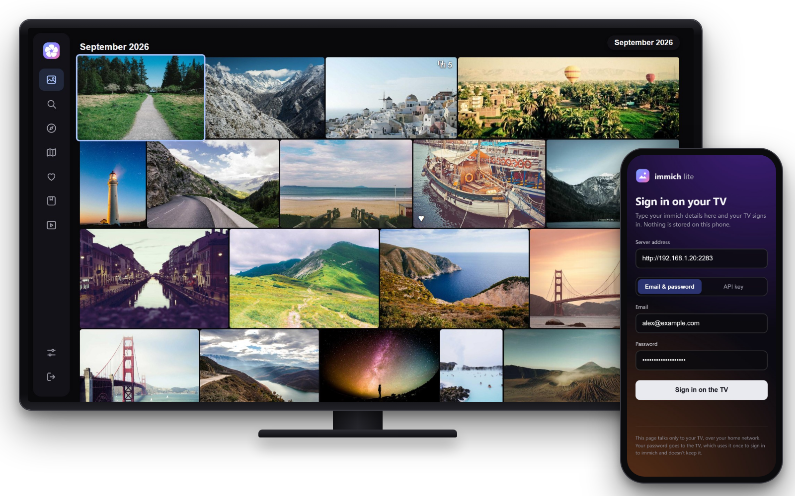

<p align="center">
  <picture>
    <source media="(prefers-color-scheme: dark)" srcset="docs/banner-dark.svg">
    
  </picture>
</p>

<p align="center">
  Your <a href="https://immich.app">immich</a> photos and videos on older LG TVs:<br>
  the 2016–2019 sets that today's immich TV apps can't run on.
</p>

<p align="center">
  <a href="https://github.com/cgbeaulieu/immich-lite/releases/latest"></a>
  <a href="https://github.com/cgbeaulieu/immich-lite/releases"></a>
  
  <a href="https://github.com/cgbeaulieu/immich-lite/actions/workflows/ci.yml"></a>
</p>

<p align="center">
  
</p>

<p align="center">
  <a href="https://github.com/cgbeaulieu/immich-lite/releases/latest/download/com.cgbeaulieu.immichlite.ipk"></a>
</p>

> Unofficial community app. Not affiliated with or endorsed by immich or FUTO. "immich" is a trademark of its owners.

LG's 2016–2019 TVs still make great screens, but their built-in web engine is too old for modern apps: the newer webOS immich clients need webOS 5 and show a black screen on anything older. immich lite is written for that old engine on purpose (plain JavaScript and CSS, no frameworks), so it runs smoothly on a TV from 2016.

**[Which app?](#which-app-for-your-tv)** · **[Install](#install)** · **[Features](#features)** · **[Screenshots](#screenshots)** · **[Signing in](#signing-in)** · **[Remote](#using-the-remote)** · **[Known issues](#known-issues)** · **[Troubleshooting](#troubleshooting)** · **[Privacy](#privacy-and-security)**

## Which app for your TV?

| Your TV | Use |
|---|---|
| **webOS 3.x** (2016–2017) | **immich lite**. Tested on an LG UH7650 (webOS 3.4.3) |
| **webOS 4.x** (2018–2019) | **immich lite**. Its engine is newer than the one this app targets, so it should work. [Tell us](https://github.com/cgbeaulieu/immich-lite/issues/new/choose) how it goes |
| **webOS 5.0 and newer** (2020 on) | [immich webOS](https://github.com/aneeshtigga/immich-webos), made for newer TVs and the inspiration for this app |

To check your version: **Settings → All Settings → General → About This TV**.

## Install

**You need:** an [immich](https://immich.app) server the TV can reach on your network, and an LG TV with webOS 3 or 4.

Download **[com.cgbeaulieu.immichlite.ipk](https://github.com/cgbeaulieu/immich-lite/releases/latest/download/com.cgbeaulieu.immichlite.ipk)** from the latest release, then pick the way that fits your TV.

### Developer mode (any TV, no rooting)

1. On the TV, install LG's **Developer Mode** app from the LG Content Store, sign in with a free [LG developer account](https://webostv.developer.lge.com/), and turn on **Dev Mode Status** and **Key Server**.
2. On your computer, install the IPK with **[webOS Dev Manager](https://github.com/webosbrew/dev-manager-desktop)** (point and click): add the TV, open *Apps*, and install the file.

   Or with LG's command-line tools:
   ```bash
   npx -p @webos-tools/cli ares-setup-device      # add the TV once
   npx -p @webos-tools/cli ares-install --device <your-tv> com.cgbeaulieu.immichlite.ipk
   ```

Developer mode switches itself off after about 50 hours unless you extend it in the Developer Mode app, and apps installed with it disappear when it does.

### Rooted TV (Homebrew Channel)

If your TV is rooted with the [webOS Homebrew Channel](https://www.webosbrew.org/), install the IPK with **webOS Dev Manager** as above. It stays installed for good. (immich lite isn't in the Homebrew Channel's app list yet.)

**Updating:** install the newer IPK the same way. Your sign-in and settings are kept.

## Features

| | |
|---|---|
| **Photos** | Your timeline laid out like immich's web app: each photo at its own shape in justified rows, grouped by day or month. Videos show ▶ and their length, favorites a ♥, stacks (bursts, edits) a ⧉ count |
| **Explore** | "On this day" memories, People, Places, and your Archive, Folders and Tags |
| **Map** | Where your photos were taken, on a dark map like immich's, grouped into bubbles. Point and click with the Magic Remote |
| **Favorites** | Photos you've starred, and star more with ▲ on the remote |
| **Albums** | Your albums and the ones shared with you, oldest or newest first as set in immich |
| **Search** | immich's smart search: "beach", "dog in the snow" |
| **Slideshow** | Turn the TV into a photo frame: all photos, favorites, memories, a person or an album, in order or shuffled, at your speed. The TV's screensaver stays away while it plays. **OK** pauses and shows where the photo was taken and who's in it |
| **Viewer** | Full screen photos and videos, with controls that fade away after a few seconds. Zoom photos with the Magic Remote wheel, seek in videos. ▼ opens the details: date, place, camera, the people in it, star rating and Add to album |
| **Partners** | Photos your partners share with you show in your timeline, as on immich's web app |
| **Settings** | Library statistics, slideshow speed and order, grouping, thumbnail size, hide videos, play videos as they show, partner switches |

## Screenshots

<table>
  <tr>
    <td width="50%"><br><b>Explore</b>: memories from this day in past years, and the people immich recognised</td>
    <td width="50%"><br><b>Photo details</b>: date, place, the people in it, star rating and Add to album</td>
  </tr>
  <tr>
    <td><br><b>Slideshow</b>: leave the TV running as a photo frame</td>
    <td><br><b>Map</b>: where your photos were taken; point at a bubble to open it</td>
  </tr>
  <tr>
    <td><br><b>Albums</b>: yours and the ones shared with you</td>
    <td><br><b>Search</b>: immich's smart search, so "travel" finds travel photos</td>
  </tr>
  <tr>
    <td><br><b>Viewer</b>: full screen, with favorite, rating and slideshow on the remote</td>
    <td><br><b>Sign in</b>: scan the QR code and sign in from your phone</td>
  </tr>
</table>

<sub>The photos in the screenshots are stock images ([credits](docs/screenshots/CREDITS.md)).</sub>

## Signing in


**With your phone (easiest):** scan the QR code on the TV's sign-in screen. Your phone opens a page with the TV's code already filled in: type your immich address and your email and password (or an API key), and the TV signs itself in. No typing with the remote.

**On the TV:** type the address, email and password with the remote, or use an API key. The address field has **http://**, **https://** and **:2283** shortcuts.

**Your server's address** is the one you'd type in a browser on the same Wi-Fi, like `http://192.168.1.10:2283`. Leaving out `http://` is fine.

<br clear="right">

<details>
<summary><b>Signing in with an API key</b></summary>

Create the key in immich under **Account Settings → API Keys**. A key with **all permissions** is simplest. To limit it, the app needs:
`user.read`, `asset.read`, `asset.view`, `asset.update` (favorites, ratings), `album.read`, `albumAsset.create` (Add to album), `person.read`, `memory.read`, `map.read`, `stack.read`,
`folder.read`, `tag.read`, `partner.read` and `partner.update` (partner photos),
`asset.statistics` and `server.storage` (statistics in Settings; without them those lines are left out),
and `asset.download` (sharp zoom: without it, zooming enlarges the screen-sized preview).

</details>

<details>
<summary><b>Partner photos</b></summary>

Photos shared with you through immich's partner sharing (**Account Settings → Partner Sharing**) show in Photos, Search and the map. immich only includes a partner whose **Show in timeline** switch is on; Settings on the TV lists your partners and has that switch for each one.

</details>

## Using the remote

| Where | Keys |
|---|---|
| Anywhere | Arrows move, **OK** opens, **Back** goes back, **Play** starts a slideshow of what's focused |
| Sidebar | **Left** from the edge of a page (or Back on a top page) opens it |
| Photo grids | **CH+ / CH−** jump three rows |
| Photo viewer | **◀ ▶** previous / next, **OK** slideshow on/off (pausing shows the date, place and people), **▲** favorite, **▼** details, **1–5** star rating (**0** clears), **CH+ / CH−** step through a stack, Magic Remote **wheel** zooms (then drag or arrows move, **Back** fits) |
| Videos | **OK**, **Play** and **Pause** play and pause; **⏪ ⏩** jump 10 seconds; **◀ ▶** jump 10 seconds while playing, move on while paused; click the time line to jump there |
| Map | Arrows move, **CH+ / CH−** zoom, **OK** opens the bubble nearest the centre |

**Magic Remote:** point and click anywhere. On the map, point at a bubble and click it, scroll to zoom, drag to move.

## Known issues

- **Portrait videos play sideways.** The TV's video hardware ignores the rotation in phone videos. immich can fix it by re-encoding them: see [#1](https://github.com/cgbeaulieu/immich-lite/issues/1).
- **Not tried yet:** webOS 4 TVs, and installing in developer mode without root (the test TV is rooted). Reports either way are welcome.
- No seeking inside a video yet, and one account at a time.

All [known issues](https://github.com/cgbeaulieu/immich-lite/issues?q=is%3Aissue+is%3Aopen+label%3A%22known+issue%22) are labelled on the issue tracker.

## Troubleshooting

<details>
<summary><b>"The TV can't find" my server</b></summary>

The TV can't use names that only your computer knows, like Tailscale or other VPN names, or `.local` names. Use the server's IP address instead, like `http://192.168.1.10:2283`. You'll find it in your router's list of devices.
</details>

<details>
<summary><b>"Couldn't reach" the server</b></summary>

Check that the TV and the server are on the same network, and that immich opens in a browser at that address. `https://` with a self-signed certificate may be refused by the TV's old software, so plain `http://` on your home network is the safe choice.
</details>

<details>
<summary><b>Search says it isn't working</b></summary>

Smart search needs immich's machine learning. Right after you add a lot of photos, immich is still indexing them and search can fail for a while. Try again later, or check **Administration → Job Queues** in immich.
</details>

<details>
<summary><b>The map is empty</b></summary>

Bubbles only show for photos with a location. The map itself needs the TV to reach the internet, since it loads the same map immich's web app uses.
</details>

<details>
<summary><b>The app vanished from the TV</b></summary>

Developer mode ran out. Extend it in the Developer Mode app, or reinstall. See [Install](#developer-mode-any-tv-no-rooting).
</details>

## Privacy and security

- **Your password is never stored.** The TV uses it once to sign in and keeps only immich's session token (or your API key), like immich's own apps.
- **Phone sign-in stays on your home network.** A small service on the TV listens only while the sign-in screen is up, needs the code shown on the TV, locks after 8 wrong codes and stops after 10 minutes.
- **Nothing goes anywhere but your immich server**, apart from the map, which loads from immich's map server like immich's web app does. No analytics, no accounts.

## Development

Want to change the app or build it yourself? See [docs/DEVELOPMENT.md](docs/DEVELOPMENT.md). Ideas and bug reports are welcome in [Issues](https://github.com/cgbeaulieu/immich-lite/issues/new/choose).

## Thanks

- [immich](https://immich.app), for the server, its API and its map.
- [immich webOS](https://github.com/aneeshtigga/immich-webos) by Aneesh Tigga, the inspiration and the app to use on newer TVs.
- [qrcode-generator](https://github.com/kazuhikoarase/qrcode-generator) by Kazuhiko Arase (MIT), which draws the sign-in QR code.
- The [webOS Homebrew](https://www.webosbrew.org/) community.

## License

[Mozilla Public License 2.0](LICENSE), except `app/lib/qrcode.js` (MIT, Copyright (c) 2009 Kazuhiko Arase). The stock photos in the screenshots are under the [Unsplash License](https://unsplash.com/license).
